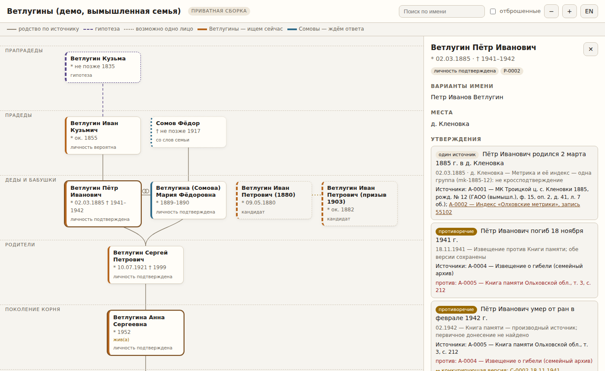

# kinship-kit — AI-assisted family history research

An evidence-first genealogy toolkit for AI agents (Claude Code, Codex, any MCP client): a **skill** (method) + the **`kin`
CLI** (all case operations, Python standard library only) + a **family-tree site** (local or published).
Family data lives in a separate private case folder — on your computer or server. Focus: former USSR and the Russian Empire.

**Demo:** https://semanticmeaning.github.io/kinship-kit/ — the family-tree site of a fictional family (public and private views, RU/EN).



## Install and first step

```bash
git clone https://github.com/semanticmeaning/kinship-kit.git && cd kinship-kit
sh install.sh            # skill → ~/.claude/skills and ~/.agents/skills, plus the `kin` command
kin --lang en setup      # asks: main surname, case title and folder, commit author (a pseudonym is fine), roles
```
Or ask your agent: “Use the kinship-kit skill, let's research the … family” — it asks the same questions first.

## Work

```bash
kin status && kin next                           # where we are and what to do next (with reasons)
kin task new metric-books --goal "Find Ivan's birth ≈1855" --hypothesis H-0001
kin search add --task T-0001 --source "Archive, f. 15, op. 2" --query "Ivan son of Kuzma" --period 1853/1857 \
    --result not-found --disallowed "does not mean he was not born there" --repeat-when "copies are found"
kin review request H-0001 --for accepted         # checked by another role (Evidence Reviewer)
kin audit && kin site serve                      # tree: http://127.0.0.1:8080
python3 examples/demo/build_demo_en.py ~/kinship-cases/demo-en   # fictional demo case in English
```

Guide (method, rules, commands): `skills/kinship-kit/references/guide.en.md`. Interface language: `--lang en`,
`KIN_LANG=en` or the case language. Status, next, audit, setup and the site are translated; some error messages and the
detailed documentation in `docs/` are Russian only for now.

Key ideas: sources are immutable and checksummed; a mention in a document is distinct from an established person;
corroboration requires two independent source groups; conflicting dates are kept as competing claims; negative searches
are logged and not repeated without a new basis; significant conclusions need an independent review of that decision;
research state is restored from data (`kin status`); the public build hides living people and fails on leaks.
Exchange: own lossless JSON export, GEDCOM 5.5.1 import/export without duplicate growth, backup/restore.

License: MIT. Based on [ex-ussr-kinship-research](https://github.com/DenisSergeevitch/ex-ussr-kinship-research) © 2026 Denis Shiryaev (MIT).
